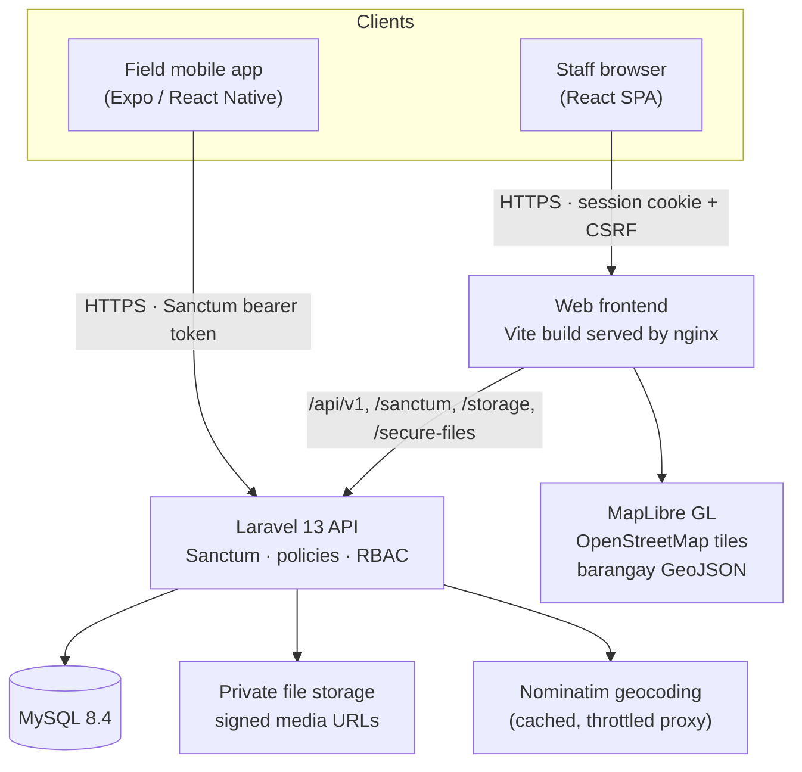

# CVO — Livestock and Poultry Dispersal Tracking System

A full-stack information system for a **City Veterinary Office (CVO)** that replaces paper-based livestock and poultry dispersal records with a centralized, map-aware digital workflow: beneficiary enrolment, animal dispersal and re-dispersal tracking, field monitoring, health records, reporting, and a public transparency dashboard.

Built as a capstone project for the City Veterinary Office of **Bayawan City, Negros Oriental, Philippines**.

---

## Table of contents

1. [Project overview](#1-project-overview)
2. [Project objectives](#2-project-objectives)
3. [Key features](#3-key-features)
4. [System architecture](#4-system-architecture)
5. [Technology stack](#5-technology-stack)
6. [User roles and permissions](#6-user-roles-and-permissions)
7. [Project directory structure](#7-project-directory-structure)
8. [Database and data management](#8-database-and-data-management)
9. [Local development setup](#9-local-development-setup)
10. [Docker deployment](#10-docker-deployment)
11. [Testing](#11-testing)
12. [Environment variables](#12-environment-variables)
13. [Security considerations](#13-security-considerations)
14. [Project status](#14-project-status)
15. [Project context](#15-project-context)
16. [Documentation](#16-documentation)
17. [License](#17-license)

---

## 1. Project overview

Local government veterinary offices run livestock and poultry dispersal programs that entrust animals to farmer-beneficiaries across many barangays. The program carries a compliance obligation: the office must know where each animal went, who holds it now, which offspring were produced, and whether pass-on or re-dispersal commitments were honored.

In practice that record usually lives in logbooks, spreadsheets, and field notebooks. Records are duplicated, locations are vague ("near the school"), and city-wide reporting means manually re-counting rows from several sources.

CVO digitizes the whole cycle:

- **Beneficiaries** are registered once, with their barangay, purok, and a map coordinate.
- **Animals** are recorded with species, classification, ear tag, and the household that holds them.
- **Dispersal events** form a permanent ownership chain — dispersal, pass-on, re-dispersal, and return to the CVO.
- **Field technicians** record visits, health interventions, vaccinations, and case notes on site.
- **Administrators** see city-wide monitoring, barangay analytics, audit history, and program reports.

The system serves CVO staff only. Beneficiaries are **records**, never login accounts, and there is no public registration path.

## 2. Project objectives

- Centralize beneficiary and animal records in one authoritative database.
- Track every livestock and poultry dispersal from release to current holder.
- Record re-dispersal and pass-on compliance so the ownership chain is auditable.
- Capture beneficiary locations geographically, down to the barangay and purok.
- Give field technicians a mobile-friendly way to record visits and GPS fixes.
- Generate reliable, filterable reports and barangay-level dispersal analytics.
- Support administrative decisions with dashboards, trends, and an audit trail.
- Publish aggregate, non-identifying program statistics for public transparency.

## 3. Key features

Only implemented modules are listed. Each is backed by API routes, database tables, and a web screen.

### Administrator

| Module | What it does |
|---|---|
| **Dashboard overview** | KPI strip, monitoring/beneficiary/visit/technician statistics, dispersal trend, and recent audit activity in one aggregate view. |
| **Monitoring records** | The livestock/poultry monitoring table: animal type and classification, MOA status, registry fields, month/year tabs, filters, bulk actions, and Excel import/export in the CVO workbook format. |
| **Beneficiary management** | Create, edit, bulk-delete, and assign technicians to beneficiary records; barangay/purok cascade, map pin picker, address geocoding, and CSV export. |
| **Technician management** | Technician directory with workload, profile drawer, and beneficiary assignment (single and bulk). |
| **Field visit monitoring** | City-wide view of technician field visits, including off-site/needs-review verdicts and adopting a captured GPS fix as the household's registered pin. |
| **Geographical mapping** | Dated dispersal snapshot on a MapLibre map with barangay polygons, per-barangay counts, record panel, per-animal flight path, and barangay search. |
| **Reports and analytics** | Five program charts (dispersal trend, animals by barangay, vaccination compliance, animal-type distribution, technician workload), spreadsheet export, and printable template export. |
| **Barangay dispersal report** | Per-barangay totals, animal mix, inflow/outflow flows, and a detail card per barangay, all under shared filters. |
| **Audit trail** | Append-only activity log with actor snapshots, field-level diffs, filters, summary, and export. |
| **User management** | Staff account creation, role assignment, email verification and resend, password reset, session revocation, deactivate/reactivate, and permanent deletion of record-free accounts. |
| **Roles and permissions** | Capability matrix per role, with a guard that prevents removing the last holder of a critical capability. |
| **System settings** | Office contact profile, alert thresholds, animal types and classifications, puroks/barangays, and health-concern hint rules. |
| **Public site content** | Veterinary announcements and transparency documents served to the public pages. |
| **Notifications** | Derived and stored alerts, unread badge, per-user preferences, and bulk read. |

### Technician

| Module | What it does |
|---|---|
| **Dashboard** | Task-oriented landing page: planned visits, assigned households, visits due, and recent activity. |
| **Assigned beneficiaries** | Only households assigned to the signed-in technician, with location and contact details. |
| **Field visits** | Record a visit with an optional on-site GPS fix, geotagged photo, verification verdict, and a justification note for off-site visits. |
| **Health records** | Clinical examinations with diagnosis, treatment, supporting photo, and follow-up date. |
| **Vaccination schedule** | Derived current cycle, history, quick recording, rescheduling, and photo evidence. |
| **Case notes** | Case records with an append-only timeline, related clinical/visit links, and photos. |
| **Animal health monitoring** | Role-scoped rollup of health status, map view, and trends. |
| **Dispersal and re-dispersal** | Record a dispersal, pass-on, re-dispersal, or return to CVO; inspect the animal's ownership chain and flight path. |
| **Geo-tagging map** | The same dated map as the administrator, scoped to the technician's assigned households. |
| **Barangay dispersal analytics** | Read-only barangay report for technicians holding the analytics capability. |
| **Notifications and profile** | Own alert feed, notification preferences, profile, password, and avatar. |
| **Mobile companion** | Expo app for sign-in and field geo-tagging of a dispersed animal at the farm. |

### Public (no sign-in)

Landing page with program overview and aggregate map, transparency dashboard (city totals, per-barangay counts, monthly reach, vaccination compliance), published announcements and documents, contact form, and privacy page. All public data is aggregated — no names, household ids, or exact farm coordinates.

## 4. System architecture



The web client and API can run as **two origins in development** (Vite on `:5173`, API on `:8005`) or as **one origin in production** (the frontend nginx serves the SPA and reverse-proxies the API). The single-origin layout keeps Sanctum's cookies first-party and removes CORS from the picture.

The mobile app authenticates with a bearer token from `POST /api/v1/token-login`, so it does not participate in the SPA cookie/CSRF flow.

## 5. Technology stack

| Layer | Technology |
|---|---|
| Backend API | Laravel 13, PHP 8.4, Laravel Sanctum |
| Web frontend | React 19, Vite 8, React Router 7, TanStack Query 5 |
| Mobile | Expo SDK 57, React Native 0.86, React Navigation 7 |
| Database | MySQL 8.4 (`utf8mb4` / `utf8mb4_unicode_ci`) |
| Authentication | Sanctum SPA cookie sessions (web) and bearer tokens (mobile) |
| Authorization | Role capability matrix (`role_permissions`) plus Laravel policies |
| Mapping / GIS | MapLibre GL 6, OpenStreetMap raster tiles, barangay GeoJSON, Nominatim geocoding proxy |
| Charts | Recharts 3 |
| Styling | Tailwind CSS 4 |
| Spreadsheets | `maatwebsite/excel` 4 (monitoring workbook, report exports) |
| Internationalisation | i18next / react-i18next (English, Filipino, Cebuano) |
| Testing | PHPUnit 12, Vitest 5 + React Testing Library, Puppeteer Core |
| Deployment | Docker Compose, nginx + PHP-FPM, Render blueprint |

## 6. User roles and permissions

The system has exactly **two staff roles**:

### Administrator (`admin`)

Owns accounts, roles, reference data, and city-wide oversight. Can open every workspace. Holds the administrative capabilities: `manage_users`, `manage_roles`, `manage_settings`, `view_reports`, `view_activity_logs`, `assign_technicians`, `manage_reference_data`, and the monitoring import/export permissions.

### Field Technician (`technician`)

Carries the field work: assigned households, field visits, geo-tagging, dispersal and re-dispersal records, health records, vaccinations, case notes, and animal health monitoring. Sees only the rows scoped to their assignments.

### Access boundaries

- Every API route is authorized server-side. The sidebar hides modules a user cannot use, but hiding is a usability layer, not the control — the capability is checked again in middleware, Form Requests, and policies.
- Capabilities live in the `role_permissions` matrix and can be adjusted on the **Roles & Permissions** screen. The matrix refuses changes that would leave no active account holding `manage_roles`.
- **Beneficiaries are records, not accounts.** There is no farmer login, no member login, and no public self-registration endpoint. Every account is staff, created by an administrator.
- There is no separate veterinarian/doctor role. Clinical work (health records, vaccinations, case notes, animal health) belongs to the technician role; the administrator can review it through all-access dashboards.

## 7. Project directory structure

```text
CVO/
├── backend/                  # Laravel API
│   ├── app/
│   │   ├── Console/Commands/  # backfills, verification and alert commands
│   │   ├── Http/
│   │   │   ├── Controllers/   # thin controllers, one per module
│   │   │   ├── Middleware/    # permission, audit, session and security headers
│   │   │   ├── Requests/      # validation + authorization
│   │   │   └── Resources/     # JSON shapes
│   │   ├── Models/            # Eloquent models and relationships
│   │   ├── Policies/          # per-record authorization
│   │   ├── Services/          # business logic and aggregations
│   │   └── Support/           # role catalogue, geo helpers, media signing
│   ├── config/               # app, auth, security, barangay reference data
│   ├── database/
│   │   ├── factories/         # test data
│   │   ├── migrations/        # full schema history (never deleted)
│   │   └── seeders/           # staff accounts + reference data
│   ├── docker/               # entrypoint, nginx, php-fpm, supervisord
│   ├── public/               # front controller
│   ├── routes/               # api.php (versioned /api/v1), console.php
│   ├── storage/              # private uploads and runtime files
│   └── tests/                # PHPUnit feature and security tests
├── frontend/                 # React + Vite SPA
│   ├── public/
│   │   └── geojson/          # Bayawan City barangay boundaries
│   └── src/
│       ├── api/              # axios client + endpoint modules
│       ├── components/       # shared UI, maps, forms, tables
│       ├── config/           # role navigation, map style, site copy
│       ├── context/          # auth, theme, toasts, offline queue
│       ├── hooks/            # data and browser hooks
│       ├── i18n/             # en / fil / ceb translations
│       ├── lib/              # map geometry, QR, offline queue, helpers
│       ├── pages/            # one screen per module
│       ├── routes/           # route table and guards
│       └── test/             # Vitest + React Testing Library
├── mobile/                   # Expo / React Native companion
│   ├── assets/
│   └── src/
│       ├── api/              # token client and endpoint modules
│       ├── context/          # auth persistence
│       └── screens/          # login, geo-tag, projects
├── e2e/                      # Puppeteer browser checks
├── docker-compose.yml        # development stack
├── docker-compose.prod.yml   # production stack (single origin)
├── Makefile                  # developer shortcuts
├── render.yaml               # Render blueprint
├── README.md                 # this file
└── READMEProduction.md       # production deployment guide
```

## 8. Database and data management

- **Database:** MySQL 8.4. All application tables are created by Laravel migrations in `backend/database/migrations/`.
- **Migrations:** the full history is retained. Migrations run automatically on container boot (`php artisan migrate --force`) and can be run manually with `php artisan migrate`.
- **Seeders:** `DatabaseSeeder` creates the two staff accounts and calls two reference seeders:
  - `BarangaySeeder` — the 28 official Bayawan City barangays from `config/barangays.php`, and a repair pass that backfills `barangay_id` on older rows.
  - `SymptomRuleSeeder` — starter health-concern hint rules, editable in System Settings.
- **Factories:** used by the automated test suite. They are not part of production seeding.
- **Seeding is off by default.** `RUN_SEEDERS=false` in both compose files, so a restart never recreates accounts or data. Seed once with `php artisan db:seed --force` or by setting `RUN_SEEDERS=true` for a single boot.
- **Idempotency:** seeders use `updateOrCreate`, so re-seeding updates existing rows instead of duplicating them.
- **Production data:** no sample beneficiaries, animals, visits, or demo accounts are created by any committed seeder. Real program data is entered by staff through the application.
- **Backups:** the production database lives in the `db_data` volume; see [READMEProduction.md](READMEProduction.md#9-backups--data) for dump and restore commands. Take a dump before any deploy that includes migrations.

## 9. Local development setup

### Prerequisites

- **Docker path (recommended):** Docker Desktop or Docker Engine with Compose v2, and about 4 GB of free RAM. No local PHP, Node.js, or MySQL required.
- **Manual path:** PHP 8.4+ with `pdo_mysql` and `pdo_sqlite`, Composer, Node.js 20+, npm, and MySQL 8.

### Option A — Docker (recommended)

```bash
cp .env.example .env
docker compose up --build
```

| Service | URL |
|---|---|
| Web app | http://localhost:5173 |
| API | http://localhost:8005 |
| MySQL | `localhost:3307` |
| phpMyAdmin (optional) | http://localhost:8081 |

The backend container waits for MySQL, runs migrations, and starts the API. Seeding is off by default. To create the two staff accounts and reference data once:

```bash
docker compose exec backend php artisan db:seed --force
```

`make help` lists the available shortcuts (`make up`, `make logs`, `make migrate`, `make seed`, `make test`, and so on).

Optional add-ons:

```bash
docker compose --profile tools up -d          # phpMyAdmin
docker compose --profile e2e run --rm e2e     # browser checks in a container
```

### Option B — run each service directly

**Backend**

```bash
cd backend
composer install
cp .env.example .env
php artisan key:generate
php artisan migrate --seed
php artisan storage:link
php artisan serve --port=8005
```

**Frontend**

```bash
cd frontend
npm install
cp .env.example .env          # VITE_API_URL=http://localhost:8005
npm run dev                   # http://localhost:5173
```

**Mobile (optional)**

```bash
cd mobile
npm install
cp .env.example .env          # point EXPO_PUBLIC_API_URL at the API
npm start
```

The API URL must be reachable **from the device**: `http://10.0.2.2:8005` for the Android emulator, `http://localhost:8005` for the iOS simulator, or `http://<LAN-IP>:8005` for a physical phone.

### Seeded staff accounts

| Username | Email | Role |
|---|---|---|
| `admin` | `kylleacibron@gmail.com` | Administrator |
| `technician` | `samplekylleuser@gmail.com` | Field Technician |

Passwords come from `SEED_ACCOUNT_PASSWORD`. When it is unset, local/testing use `password`, and production generates a random password printed once during seeding. Use **Forgot password?** to set a real password.

## 10. Docker deployment

| File | Purpose |
|---|---|
| `docker-compose.yml` | Development stack: MySQL, Laravel dev server, Vite dev server with HMR, optional phpMyAdmin and e2e shell. |
| `docker-compose.prod.yml` | Production stack: MySQL, Laravel under nginx + PHP-FPM (supervisord), frontend nginx serving the built SPA and reverse-proxying the API. Only the frontend port is published. |
| `.env.example` | Development compose variables and development defaults. |
| `.env.production.example` | Production compose variables with placeholders for secrets. |
| `backend/Dockerfile` | Multi-stage image with `dev` and `production` targets. |
| `frontend/Dockerfile` | Multi-stage image with `dev` and `production` targets. |
| `render.yaml` | Two Render Docker web services built from the repository root. |

Development:

```bash
cp .env.example .env
docker compose up --build
```

Production:

```bash
cp .env.production.example .env.production
# fill in DB_PASSWORD, DB_ROOT_PASSWORD, APP_KEY, APP_URL, SANCTUM_STATEFUL_DOMAINS
docker compose --env-file .env.production -f docker-compose.prod.yml up -d --build
```

The production app is served on `WEB_PORT` (default **8080**). The API and database are not published; the frontend nginx proxies `/api`, `/sanctum`, `/storage`, `/secure-files`, and `/up` to the backend. `VITE_API_URL` is a **build-time** value — leave it empty for the single-origin proxy.

Development ports (5173/8005/3307) and the production port (8080) are intentionally different; do not mix them.

See [READMEProduction.md](READMEProduction.md) for the full deployment guide, including TLS, Render setup, backups, upgrades, and troubleshooting.

## 11. Testing

### Backend

```bash
docker compose exec backend php artisan test
# or, with a local PHP environment:
cd backend && php artisan test
```

The suite runs against **in-memory SQLite** (`backend/phpunit.xml` forces the connection), so it never touches the development or production MySQL database.

### Frontend

```bash
docker compose exec frontend npm test        # Vitest + React Testing Library
docker compose exec frontend npm run lint    # oxlint
docker compose exec frontend npm run build   # production build
```

### End-to-end

The `e2e/` scripts drive a real Chrome against a running development stack. They are diagnostic and regression checks, not a CI-gated suite.

```bash
cd e2e
npm ci
CHROME_PATH="/path/to/chrome" node smoke.mjs
```

Set `E2E_BASE` to point at a different frontend URL. On Windows the default Chrome path is used when `CHROME_PATH` is unset. Inside the `e2e` Compose profile, Chromium is installed in the container and `CHROME_PATH` is set automatically.

### Mobile

The mobile app has no automated test suite. Validate its configuration with:

```bash
cd mobile
npx expo config --type public
```

## 12. Environment variables

Real environment files are gitignored. Only `*.example` templates are committed.

| File | Scope |
|---|---|
| `.env` | Docker Compose variables for development (copy of `.env.example`). |
| `.env.production` | Docker Compose variables for production (copy of `.env.production.example`). |
| `backend/.env` | Laravel configuration for a host-run backend. |
| `backend/.env.docker.example` | Laravel configuration created inside the development container. |
| `frontend/.env` | `VITE_API_URL` and the optional dev port. |
| `mobile/.env` | `EXPO_PUBLIC_API_URL`. |

Important groups:

- **Database:** `DB_DATABASE`, `DB_USERNAME`, `DB_PASSWORD`, `DB_ROOT_PASSWORD`, `DB_HOST_PORT`.
- **Application:** `APP_KEY`, `APP_URL`, `APP_ENV`, `APP_DEBUG`, `FRONTEND_URL`.
- **Session / Sanctum:** `SESSION_DRIVER`, `SESSION_DOMAIN`, `SESSION_SECURE_COOKIE`, `SANCTUM_STATEFUL_DOMAINS`, `CORS_ALLOWED_ORIGINS`.
- **Mail:** `MAIL_MAILER`, `MAIL_HOST`, `MAIL_PORT`, `MAIL_USERNAME`, `MAIL_PASSWORD`, `MAIL_FROM_ADDRESS`. `MAIL_PASSWORD` is a Google App password, never committed.
- **Seeding:** `RUN_SEEDERS`, `SEED_ACCOUNT_PASSWORD`.
- **Security tuning:** `SECURITY_SESSION_IDLE`, `SECURITY_SESSION_ABSOLUTE`, `SECURITY_TOKEN_IDLE`, `SECURITY_TOKEN_ABSOLUTE`, lockout and upload limits (see `backend/config/security.php`).
- **Geocoding:** `GEOCODING_CA_BUNDLE` for hosts without a CA bundle.

## 13. Security considerations

- **Authentication:** Sanctum session cookies for the SPA (CSRF-protected) and hashed bearer tokens for mobile. Passwords are hashed with bcrypt.
- **Authorization:** capability checks on every route, reinforced by Form Requests and policies. Row-level scoping limits technicians to assigned households.
- **Account lifecycle:** new staff accounts require email verification before sign-in; the verification token is hashed, single-use, and expires. Deactivation is a soft delete that preserves referenced records.
- **Password recovery:** six-digit email OTP stored only as a bcrypt hash, 10-minute expiry, five attempts, enumeration-safe responses, and a single-use reset ticket. A password change revokes all sessions and tokens.
- **Session hardening:** idle and absolute session ceilings, per-account login lockout, and "remember me" with a bounded lifetime.
- **Uploads:** validated image types and size caps, images sanitized on write, and private-disk media served through signed, expiring URLs rather than a public directory.
- **Transport:** security headers middleware, HSTS in production, `SESSION_SECURE_COOKIE=true` behind HTTPS, and only the frontend port published in production.
- **Secrets:** `.env` files are gitignored; only placeholder templates are committed. `APP_KEY`, database passwords, and the mail App password belong in the untracked environment file or a secret manager.
- **Production seeding:** disabled by default, so no demo accounts or sample records can appear in a deployed environment.
- **Public surfaces:** rate-limited, cached, and aggregate-only. The contact form is stored and forwarded best-effort; no public endpoint exposes beneficiary identities or exact coordinates.

## 14. Project status

**Actively in development.**

Implemented and working:

- Staff authentication, email verification, password reset, session and lockout controls.
- Beneficiary registry, animal registry, monitoring records, and technician assignment.
- Dispersal, pass-on, re-dispersal, and return-to-CVO ownership chain with flight paths.
- Field visits with GPS fixes and geotagged photos.
- Health records, vaccination schedule, case notes, and animal health rollup.
- Dated dispersal map, barangay analytics, reports, Excel import/export, and template export.
- Audit trail, user management, roles and permissions, system settings.
- Announcements, transparency documents, public transparency dashboard, and contact form.
- Docker development and production stacks, and a Render blueprint.

Under development or limited:

- The **mobile app** covers sign-in and field geo-tagging. The web app has substantially broader functionality; mobile parity for visits, photos, and offline records is not complete.
- The offline queue and conflict logging exist in the web client, but offline-first field workflows still need hardening.
- Report and analytics coverage is being expanded; treat the current chart set as the implemented baseline.

## 15. Project context

CVO is developed as a capstone project for the **City Veterinary Office of Bayawan City, Negros Oriental, Philippines**, to support its livestock and poultry dispersal program across the city's 28 barangays. The barangay list, geographic reference data, and program vocabulary follow the office's actual administrative structure.

## 16. Documentation

- [READMEProduction.md](READMEProduction.md) — production deployment, TLS, Render, backups, upgrades, troubleshooting.
- [backend/README.md](backend/README.md) — API structure, authentication, and endpoint groups.
- [frontend/README.md](frontend/README.md) — SPA structure, map stack, and auth flow.
- [mobile/README.md](mobile/README.md) — Expo setup and the field geo-tagging screen.
- [e2e/README.md](e2e/README.md) — running the browser checks.

## 17. License

No open-source license has been specified for this project. All rights are reserved by the project authors unless a license is added.

The `mobile/LICENSE` file is the MIT license that ships with the Expo project template; it covers that scaffold, not the CVO system as a whole.
